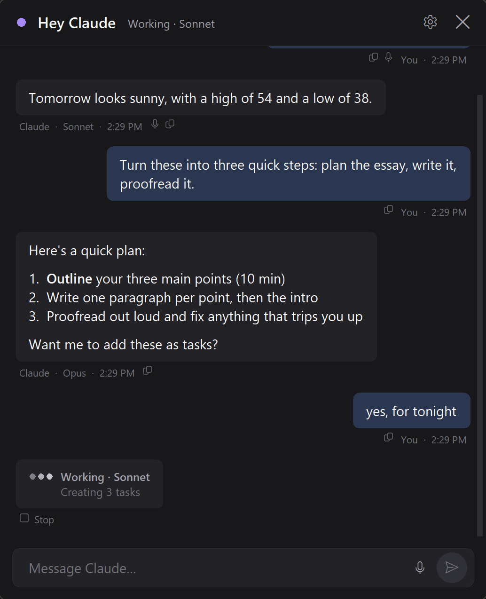
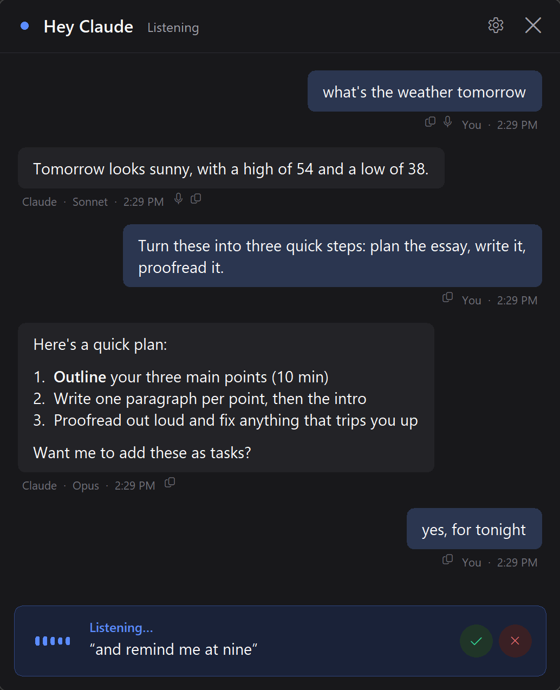

# Hey Claude!

**A local "Hey Claude" wake word for Windows that hands your spoken (or typed) commands to Claude Code.**

Say *"Hey Claude, close Chrome"*, *"Hey Claude, what's on my calendar today?"* or *"Hey Claude, add this to my tasks"*.
Speech recognition and the voice run on your laptop. Only the words after "Hey Claude" (and, when you
point at the screen, screenshots) go to Claude. Simple things happen instantly. Everything else goes to an
always-warm Claude Code session (Haiku, Sonnet or Opus, picked for the job), which can actually *do* things on
your computer: open apps, run PowerShell, use your Claude connectors. Then it answers out loud.

There's also a small chat window: tap **F20** (or click the pill) to type to it, scroll back through the
conversation, or hold **F20** to talk.

<p align="center">
  
  &nbsp;
  
</p>

---

## What it does

- **Wake word, fully local.** [faster-whisper](https://github.com/SYSTRAN/faster-whisper) (`tiny.en` to spot
  "Hey Claude" fast, `small.en` to confirm and transcribe). A chime and a pill appear as soon as it hears you.
  A false-wake filter (loudness, recognizer confidence, plus a tiny Haiku "was that meant for me?" check)
  quietly ignores roommates, videos and noise.
- **Keep talking.** It keeps collecting your command while you speak. Short pauses are fine. A **check button**
  sends it now; **X** or Esc cancels.
- **Instant actions** with no model call (~0.2 s): open/close apps, exact volume, media keys,
  maximize/minimize, the time and date, plus any **script skills** you've taught it (see below).
- **The right model for the job.** Simple commands go to Haiku. Screen, tasks, calendar and multi-step work
  go to Sonnet. Research, writing and planning go to Opus. Say "use Opus…" to choose. Each model is a
  long-running `claude -p` session, so there's no start-up delay.
- **Sees your screen when you mean it.** "this", "that page", "here" attach a screenshot of every monitor,
  taken the moment you spoke. The HUD itself is excluded from them.
- **Talks back.** [Kokoro](https://github.com/thewh1teagle/kokoro-onnx) TTS, sentence by sentence. It never
  clips the first word on Bluetooth speakers (see *How it works*). Say "Hey Claude" over it to interrupt.
- **Conversations.** Commands share context across models until 15 quiet minutes pass, or you press **New
  conversation**. A few seconds after each reply the mic stays open, so a follow-up needs no wake word.
  If it asked you a question, it waits for your answer.
- **Memory.** `permanent.md` holds things you tell it to remember. `learned.md` is its own notes, reviewed
  automatically at the end of every conversation, including after a restart.
- **Safety first.** Claude Code's auto permission mode checks every action. Destructive or outward-facing
  actions always get a confirmation question. **Sending email is behind a code-enforced approval lock**
  (`approval_gate.py`): Send is blocked unless you said or typed a clear "yes" to its question in the last 90 seconds.

### The HUD and chat window

| You do | It does |
|---|---|
| Push the mouse against the **top-center edge** of the screen | A pill slides down. Move away and it slides back up. |
| **Hover** the pill | It grows a little to show the latest messages |
| **Click** the pill, or **tap F20** | Opens the chat window: the full conversation, smooth scrolling, a text box |
| Type and press **Enter** | Sends it (Shift+Enter for a new line, ↑ for your last message). Typed replies are shown as text (with formatting). Ask to hear it ("say it out loud", "read it to me") and it's spoken too. |
| **Hold F20**, or click the mic | Listens like you said "Hey Claude" (push-to-talk) |
| Say **"Hey Claude"** with the chat open | The text box becomes a listening panel, then your words and the reply land in the chat |
| **Stop** under "Working…" | Abandons the request. The model restarts fresh but keeps the conversation as context. |
| Gear ⚙ → **New conversation** | Starts a new log. The old one is kept, and memories and settings carry over. |
| **X**, **Esc** or **F20** | Closes the chat. It otherwise stays on top while you work. |

Each message has a copy button (or right-click it). At the top of the chat you can load the previous
conversation.

### Script skills: teach it new instant commands

Say *"whenever I say 'flip a coin', answer heads or tails — make that a skill"* (or *"make that a skill"* right
after it did something useful). Claude writes a small script and a manifest into `workspace/skills/<name>/`, tests it
once, and from then on that command runs the script **directly, with no model call**. That's about as fast as the
built-in instant commands (a PowerShell skill takes ~0.3 s). The chat labels these replies **Skill: name**.

```json
{
  "name": "Screen brightness",
  "triggers": ["(?:set|change) (?:the )?brightness (?:to )?{n}(?: ?%| percent)?", "brightness {n}(?: ?%| percent)?"],
  "params": {"n": {"type": "int", "min": 0, "max": 100}},
  "script": "run.ps1",
  "args": ["{n}"],
  "reply": "[silent] Brightness {n}%.",
  "approval": false,
  "timeout": 10
}
```

Triggers are regular expressions matched against the whole command, and `{n}` captures a parameter (number words
like "seventy five" work too). `reply` can use `{output}` (what the script printed), or `[silent]` to just flash
"Done". Two samples ship in [`skills-examples/`](skills-examples): screen brightness and battery status. See
[`skills.py`](skills.py) for the full format.

Skills can't get around the safety rules:

- **A new or changed skill is not trusted yet.** Its first run goes through the model's own tools, so Claude Code's
  permission checks see it. Only then does it run instantly. The trust list lives outside the workspace.
- **Anything destructive or outward-facing always asks first.** A static scan forces approval for scripts that
  delete, overwrite, kill, shut down, change settings or send. The model then asks the confirmation question and
  runs the script only after a clear yes.
- **No downloaded code, no installs.** Scripts that download-and-run code or install software are disabled.
- **Timeouts and sandboxed arguments.** Each run has a timeout (default 15 s, at most 60). Spoken values are passed as
  plain arguments, never through a shell. Scripts must be `.ps1` or `.py` inside their own folder, and triggers so
  broad they'd catch every command are rejected.
- If a skill fails, the request falls back to the normal model, along with the error, so it can do the job (and
  fix the script).

### On battery

The always-on wake word only runs while plugged in or docked, to save power. Everything else still works on
battery: the HUD, the chat, typing, and **holding F20 to talk**. The mic opens just for that command and its
reply, then closes again.

---

## Requirements

- Windows 10/11 (uses Win32 APIs directly; no extra Windows packages)
- Python 3.11
- [Claude Code](https://docs.claude.com/en/docs/claude-code) installed with the native installer
  (`%USERPROFILE%\.local\bin\claude.exe`) and signed in
- A microphone. An F20 key is optional (many mice and macro pads can send it).

## Install

```powershell
git clone https://github.com/shawnm07/Hey-Claude.git
cd Hey-Claude
py -3.11 -m venv .venv
.\.venv\Scripts\python.exe -m pip install -r requirements.txt
```

**Speech models** (download once into `models\`, about 600 MB):

```powershell
.\.venv\Scripts\python.exe -c "from faster_whisper import WhisperModel as W; [W(m, device='cpu', compute_type='int8', download_root='models') for m in ('small.en','tiny.en')]"
```

**Voice:** download `kokoro-v1.0.int8.onnx` and `voices-v1.0.bin` from the
[kokoro-onnx releases](https://github.com/thewh1teagle/kokoro-onnx/releases) (model files v1.0) into `voice\`.

**Try it:**

```powershell
.\.venv\Scripts\python.exe hey_claude.py --say "Hello, I'm Claude."   # test the voice
.\.venv\Scripts\python.exe hey_claude.py --debug                      # run with a console, logging every phrase
```

**Start it at sign-in** (no console window):

```powershell
$dir = (Get-Location).Path
$action = New-ScheduledTaskAction -Execute "$dir\.venv\Scripts\pythonw.exe" -Argument "`"$dir\hey_claude.py`"" -WorkingDirectory $dir
Register-ScheduledTask -TaskName "Hey Claude" -Action $action -Trigger (New-ScheduledTaskTrigger -AtLogOn -User $env:USERNAME)
```

## Make it yours

On first run Hey Claude creates its private workspace files, which are git-ignored and never leave your computer:

| File | What it is |
|---|---|
| `workspace/CLAUDE.md` | Instructions for the assistant, created from `CLAUDE.example.md`. Add your task app, lists, school or work context, and helper scripts here. |
| `workspace/instructions.md` | Tone and habits ("be more concise"). It can change this itself when you ask. |
| `workspace/memory/` | `permanent.md` (what you told it to remember), `learned.md` (its own notes), `about-user.md` (your profile) |
| `workspace/settings.json` | Models per tier, effort, voice, timings, `chat_hud`. It can edit this by voice ("use Sonnet for simple stuff"). |
| `workspace/conversations/` | One JSON-lines log per conversation, append-only |
| `workspace/skills/` | Your script skills (starts with the samples) |

It may change its settings, instructions and memory by voice, but never its own code. For that it tells you
to ask in the Claude app.

Set `"chat_hud": false` in `settings.json` (then restart) to go back to the plain status pill with no chat window.

## How it works

```
mic ─► energy gate ─► tiny.en: "Hey Claude"? ─► small.en transcribes ─► false-wake filter
                                                                            │
     typed in the chat / F20 hold ─────────────────────────────────────────┤
                                                                            ▼
                         instant local action ◄── router ──► warm Claude Code session
                                                              (Haiku / Sonnet / Opus,
                                                               stream-json over stdin)
                                                                            │
          HUD: pill + chat window (Tk) ◄── reply ──► Kokoro TTS ─► speaker
```

A few details that took some figuring out:

- **No clipped first words on Bluetooth speakers.** Many speakers mute their amplifier on pure digital silence
  and take about half a second to wake. So "silence" is an inaudible 20 Hz tone at -40 dBFS, and the speaker is
  woken the moment you say "Hey Claude", while Claude is still thinking.
- **No choppy voice.** Task Scheduler starts programs at below-normal priority. Hey Claude raises itself to
  normal and runs playback on an MMCSS "Pro Audio" thread with a 0.4 s buffer.
- **The HUD never steals focus** (`WS_EX_NOACTIVATE`) until you open the chat. Closing the chat gives focus
  back to the window you were in. F20 uses `RegisterHotKey` plus key-state polling for hold detection, not a
  global keyboard hook, so typing elsewhere is never slowed down.
- **Screenshots exclude the HUD** with `SetWindowDisplayAffinity(WDA_EXCLUDEFROMCAPTURE)`, only for the
  moment the screenshot is taken.

### Files

| File | |
|---|---|
| `hey_claude.py` | Listener, wake word, routing, Claude sessions, voice, local actions |
| `hud.py` | The status pill and chat window (Tkinter, canvas-rendered, light markdown) |
| `chatlog.py` | Append-only conversation logs |
| `skills.py` | Script skills: manifests, trigger matching, safety scan, runner |
| `skills-examples/` | Sample skills, copied to `workspace/skills/` on first run |
| `approval_gate.py` | Claude Code `PreToolUse` hook that enforces the email-send approval lock |
| `tools/` | Gmail compose / send helpers (browser only; no email API access) |
| `workspace/CLAUDE.example.md` | Template for the assistant's instructions |

## Privacy

- Audio is never saved or uploaded. Only the text after the wake word (or what you type) goes to Claude, plus
  screenshots when your command refers to the screen.
- Conversations, memory, settings and screenshots stay in `workspace/` on your machine and are git-ignored.
- Connectors that could send messages on your behalf (Gmail, Slack and similar) are blocked for its Claude sessions.

## Troubleshooting

- Everything is logged to `hey-claude.log` next to the script.
- "Claude Code isn't signed in": run `claude` once in a terminal and sign in.
- No pill when you push the mouse to the top edge: it only triggers in the middle of the **primary** screen's
  top edge, with no mouse button held.
- F20 does nothing: another app may already own F20. Check the log for "F20 hotkey unavailable".

## License

[MIT](LICENSE): use it, change it, share it. Just keep the copyright notice.
